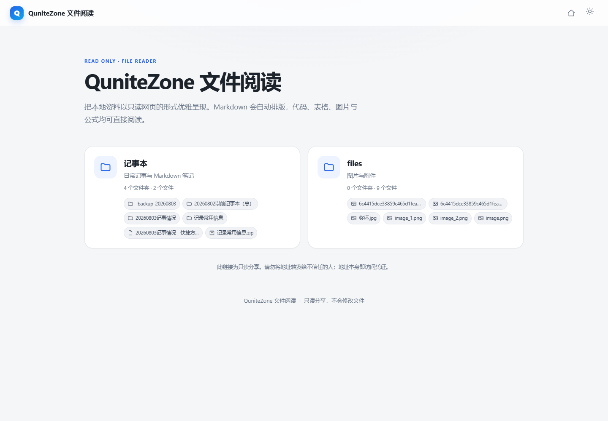
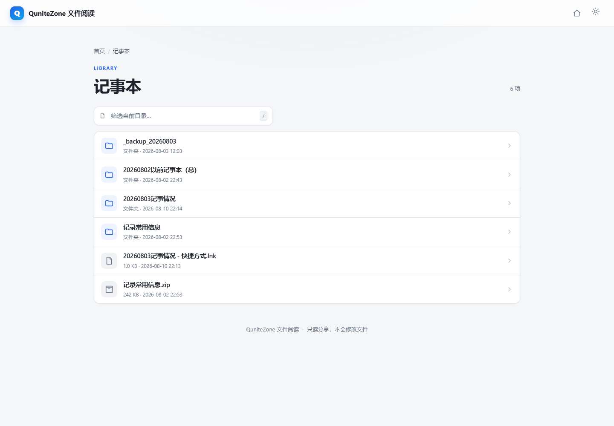
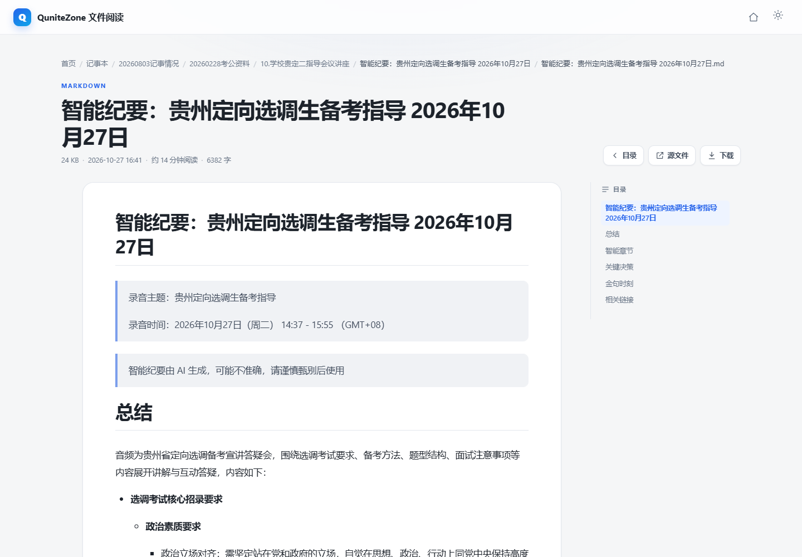
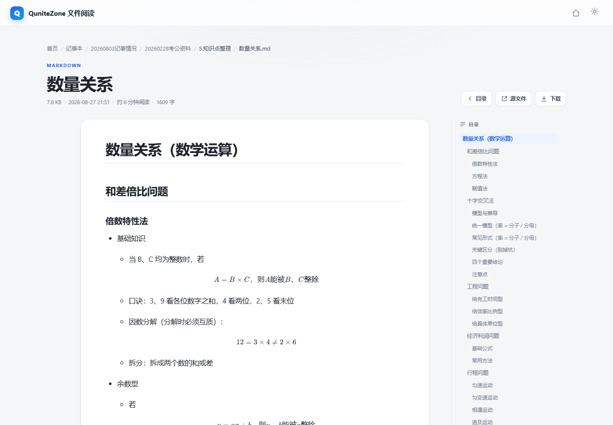
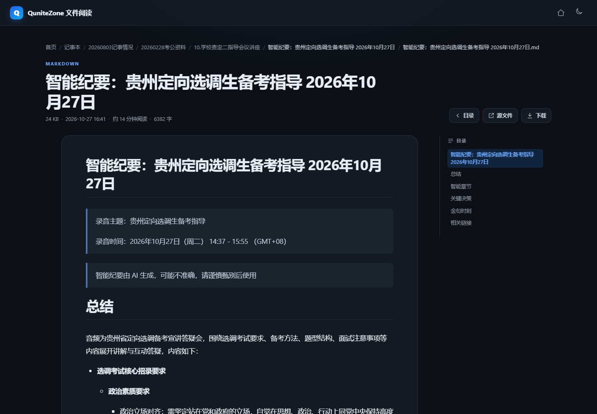
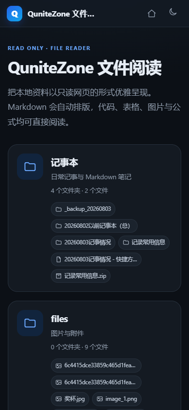
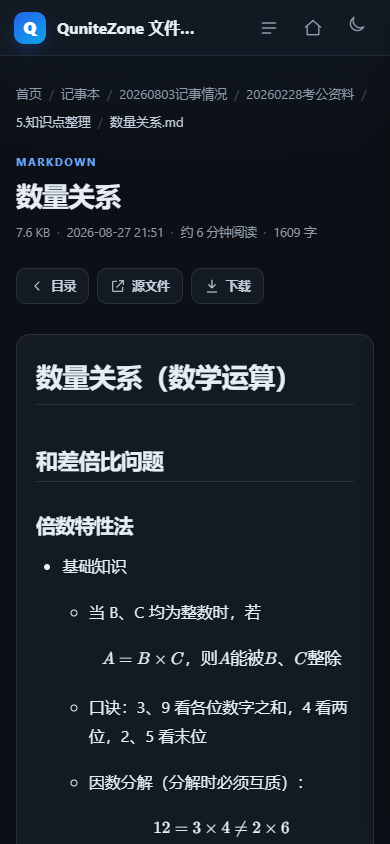
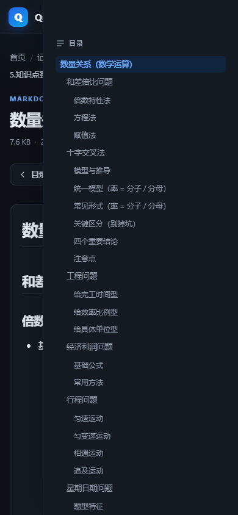

# ShareSite for VS Code

把本地的 Markdown 笔记、图片和文档，变成一个**只读、可分享、能直接丢给别人的网页**——同时保留你在 VS Code 里看到的那份排版。

ShareSite 由两部分组成：

- `server/`：一个跑在本机的 Node.js 只读文件站点，负责把目录渲染成浏览页、把 Markdown 渲染成阅读页。
- `extension/`：VS Code 扩展「阅读分享链接」，在编辑器标题栏 / 资源管理器右键，一键复制 8 位短链接或直接在浏览器打开。

> 设计目标很简单：**写作用 VS Code，分享用浏览器。** 不需要把仓库推到公开平台，也不用导出 HTML，链接发出去对方直接能看。

---

## 效果

首页：按「根目录」分组列出可分享的内容，带条目搜索。

目录浏览：面包屑、文件类型图标、大小与修改时间。

Markdown 阅读页：代码高亮 + 复制按钮、图片点开看大图、右侧悬浮目录。

公式支持（KaTeX），深浅色跟随系统、也能手动切换。



移动端自适应，目录变成抽屉。







---

## 特性

**阅读体验**

- Markdown 渲染：表格、任务列表、脚注、引用、代码高亮、KaTeX 公式
- 右侧悬浮目录，滚动时自动高亮当前章节；点击标题可复制锚点
- 代码块语言标签 + 一键复制
- 图片点击放大（lightbox），移动端手势友好
- 深浅色主题：跟随系统，也能手动切换并记住选择
- 顶部阅读进度条
- 同一套配色：笔记里手写的 `<span style="color:...">` / `<mark>` 会被归一到一组固定语义色，深浅色下都可读（见下文「颜色归一」）

**分享链路**

- 只读：站点只做 `GET`，没有任何写入、上传、删除接口
- 白名单目录：只有 `config.json` 里 `enabled: true` 的根目录可访问，其余一律 404
- Token 门禁：所有页面都在 `/s/<token>/` 下，token 用常量时间比较
- 8 位短链接：`/s/<token>/AbCd1234`，比一长串 URL 编码友好得多
- 本地 API `/api/link`：扩展把「根目录/相对路径」换成短 id；服务没起时自动回退成带路径的长链接
- 旧链接兼容：`?p=` 里只有相对路径的老链接，会按根目录顺序补全后再解析

**工程细节**

- 路径穿越防护：拒绝 `..`、盘符、`\0`，`realpath` 之后再确认仍在根目录内（软链接也逃不出去）
- CSP `default-src 'none'`，只放行站内样式/脚本/图片
- `Referrer-Policy: no-referrer`、`X-Frame-Options: DENY`、`X-Content-Type-Options: nosniff`
- HTML 走 `sanitize-html`，脚本、事件属性、`javascript:` 链接全部剥掉
- `robots.txt` 全站 disallow，页面 `Cache-Control: private, no-store`
- SVG 以 `sandbox` CSP 返回，避免内嵌脚本
- 默认只监听 `127.0.0.1`，公网入口交给反向代理 / 隧道，服务本身不直接暴露

---

## 目录结构

```
ShareSite-for-VSCode/
├── extension/              # VS Code 扩展（纯 CommonJS，无需打包）
│   ├── extension.js
│   └── package.json
├── server/                 # 只读文件站点
│   ├── server.js           # 路由入口
│   ├── config.example.json # 配置模板（复制成 config.json）
│   ├── lib/
│   │   ├── config.js       # 读取并校验配置
│   │   ├── paths.js        # 虚拟路径 → 真实路径（含越界防护）
│   │   ├── markdown.js     # Markdown 渲染 + 清洗 + 颜色归一
│   │   ├── links.js        # 8 位短 id 分配与持久化
│   │   ├── templates.js    # 页面模板
│   │   └── util.js         # 文件类型 / MIME / 格式化
│   ├── public/             # 样式、脚本、图标
│   ├── tests/              # 扩展逻辑测试（自带临时目录，可直接跑）
│   ├── start-share-site.ps1
│   ├── stop-share-site.ps1
│   └── status-share-site.ps1
├── scripts/
│   ├── New-VSCodeShareLink.ps1  # 命令行生成链接
│   ├── install-extension.ps1    # 把扩展复制进扩展目录
│   └── install-autostart.ps1    # 登录时自动启动站点
└── docs/
    └── 部署与运维.md
```

---

## 快速开始

### 0. 环境

- Node.js **18+**（开发时用的是 22）
- Windows 下附带的 `.ps1` 脚本需要 PowerShell 5.1+；其他系统直接用 `node server.js`

### 1. 安装依赖

```bash
cd server
npm install
```

### 2. 写配置

```bash
cp config.example.json config.json
```

生成一个随机 token（至少 24 个字符）：

```bash
node -e "console.log(require('crypto').randomBytes(24).toString('base64url'))"
```

把结果填进 `config.json` 的 `token`，并把 `roots` 改成你真正想分享的目录。

> `config.json` 已经在 `.gitignore` 里。**不要把真实 token 提交到仓库。**

### 3. 启动

```bash
npm start
```

或者用 PowerShell 脚本（会写 pid、日志，方便 stop/status）：

```powershell
powershell -ExecutionPolicy Bypass -File server\start-share-site.ps1
```

打开 `http://127.0.0.1:8010/s/<token>/` 就能看到首页。

### 4. 安装 VS Code 扩展

```powershell
powershell -ExecutionPolicy Bypass -File scripts\install-extension.ps1
```

重启 VS Code 后，在命令面板搜索「分享」，或在文件标签页标题栏点地球图标。

> 如果你用的是 code-server / serve-web，把扩展目录换成它的数据目录再装： `-ExtensionsDir "C:\Users\<你>\.code-serve-web\data\extensions" -Register`

---

## 配置说明

| 字段 | 默认值 | 说明 |
| --- | --- | --- |
| `token` | 无（必填） | 分享口令，≥ 24 字符；所有页面路径都带着它 |
| `host` | `127.0.0.1` | 监听地址。建议保持回环，公网交给反代 |
| `port` | `8010` | 监听端口 |
| `baseUrl` | 空 | 对外访问的地址，用于生成分享链接；为空时用 `http://host:port` |
| `siteName` | `QuniteZone 文件阅读` | 首页标题 |
| `siteDescription` | 只读文件浏览与 Markdown 阅读 | 首页副标题 |
| `roots[]` | 无（必填） | 分享根目录，见下 |
| `exclude[]` | 空 | 额外排除的目录/文件名（不区分大小写） |
| `maxMarkdownBytes` | 8 MB | 超过则返回 413 |
| `maxTextBytes` | 2 MB | 同上 |

`roots` 的每一项：

```json
{
  "name": "notes",
  "path": "D:\\QuniteZoneData\\notes",
  "enabled": true,
  "description": "个人笔记"
}
```

- `name` 会成为 URL 里的第一段（`/s/<token>/notes/...`），尽量用英文、别带斜杠
- `path` 必须是已存在的目录，否则启动时会被跳过并打警告
- `enabled: false` 的目录完全不对外，扩展也会提示「未启用」

配置也可以用环境变量 `QGZ_SHARE_CONFIG` 指向别的位置，这样站点和扩展可以共用一份配置。

---

## VS Code 扩展

| 命令 | 位置 | 作用 |
| --- | --- | --- |
| 分享：在浏览器中打开 | 标题栏 / 右键 | 生成链接并用默认浏览器打开 |
| 分享：复制阅读链接 | 标题栏 / 右键 | 复制当前文件的链接 |
| 分享：复制所在目录的浏览链接 | 右键 | 复制当前文件所在目录的链接 |
| 分享：复制阅读站点首页链接 | 命令面板 | 复制首页链接 |

设置项：

| 设置 | 说明 |
| --- | --- |
| `qgzShare.configPath` | 配置文件路径。留空时依次尝试环境变量 `QGZ_SHARE_CONFIG`、`~/.qgz-share/config.json` |
| `qgzShare.baseUrl` | 覆盖 `config.json` 里的 `baseUrl` |
| `qgzShare.shortLinks` | 是否优先用 8 位短链接，默认开启 |

实现上有两个容易踩的坑，已经处理了：

1. **自定义编辑器**（比如 Markdown 编辑器扩展的 webview）打开时 `activeTextEditor` 是 `undefined`，扩展会退回到活动标签页的 `input.uri`。
2. **差异编辑器**（`TabInputTextDiff`）优先取 `modified` 一侧。

### 短链接是怎么来的

```
VS Code 扩展 ──GET /api/link?vpath=notes/测试/示例.md──▶ 本机站点
                     ◀── { id: "AbCd1234" } ──
浏览器 ──▶ https://你的域名/s/<token>/AbCd1234
```

`lib/links.js` 把 vpath 映射成 8 位 id（字母表去掉了 `0/O/1/l/I`），存到 `data/links.json`，写入前做原子替换。id 一旦分配就不会变，所以链接可以长期发出去。

服务没起、超时（1.2 秒）或返回异常时，扩展静默回退成 `/view?p=...` 长链接——功能不会断，只是链接长一点。

---

## 颜色归一

笔记里常常混着手写颜色：

```html
<span style="color: rgb(229, 87, 87);">重点</span>
<mark data-color="#ff8c0066" style="background-color: rgba(255, 140, 0, 0.4);">高亮</mark>
```

直接放行会有两个问题：同一篇文章里能出现十种红、十种黄；深色主题下又经常看不清。

`lib/markdown.js` 在清洗阶段做了两件事：

1. 读出内联样式里的颜色，按**色相**归到 `red / orange / yellow / green / blue / purple / grey` 七组；
2. 丢掉原来的 `style`，换成 `md-tc-red`（文字色）/ `md-hl-orange`（高亮底色）类名。

实际色值只由 CSS 变量决定，所以深浅主题各有一套，改配色只改一处：

```css
:root {
  --ink-red: #d94b4b;
  --hl-orange: rgba(255, 140, 0, .3);
}

[data-theme="dark"] {
  --ink-red: #f07171;
  --hl-orange: rgba(255, 140, 0, .22);
}
```

同时统一了：行内代码、危险色、目录悬停、阅读进度条、文件类型图标——都从同一组变量取色。

---

## 测试

```bash
cd server
node tests/extension.test.cjs
```

测试用最小 `vscode` mock 加载 `extension/extension.js`，在临时目录里自己建分享根目录，不依赖本机任何真实文件，覆盖：短链接生成、服务不可用回退、未启用目录提示、目录外提示、自定义编辑器、差异编辑器、`vscode-remote` 路径映射。

---

## 部署到公网

站点默认只监听 `127.0.0.1`，对外暴露有两种常见做法：

1. **反向代理**（Nginx / Caddy）把 `/s/` 转发到 `127.0.0.1:8010`，再配 HTTPS；
2. **隧道**（Cloudflare Tunnel / frp）把本地端口映射出去，前提是隧道本身有访问控制。

无论哪种，都建议：

- 只转发 `/s/` 与 `/assets/`，不要把 `/api/link` 暴露到公网；
- 反代层再加一层访问策略（Cloudflare Access、Basic Auth 或 IP 白名单）；
- 定期轮换 `token`——换掉之后旧链接立即失效。

细节见 docs/部署与运维.md。

---

## 安全边界

说清楚它**不**做什么：

- 不是身份认证系统。**知道 token 的人就能看启用目录下的所有内容**，这是分享链接的语义。要区分「谁能看哪部分」，请拆成多个部署、多个 token。
- 不是网盘。没有上传、删除、重命名，只有读取和下载。
- 不索引文件内容，也不做搜索（只有目录页的条目名过滤）。
- 不会自动递归子目录以外的位置；`data/links.json` 里只有路径字符串，不含文件内容。

如果 `roots` 里混进了含身份证、家庭照片之类的目录，请把它的 `enabled` 改成 `false`，而不是指望 token 保密。

---

## License

[MIT](LICENSE)